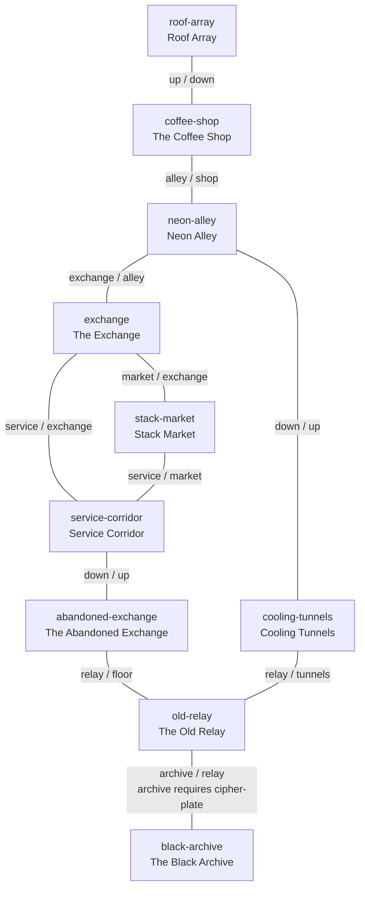

# World overview

The playable world is ten locations in one process. Identifiers, exits, and objects are defined in `crates/coffee-world/src/undernet.rs` and checked against `assets/world/implemented.graph`. This document explains how those rooms sit together. It does not add commands.

New operators appear in `coffee-shop`. Positions persist. Leaving the session does not move you.

## What the Undernet is

A local network of rooms under and behind a wet commercial block: a coffee shop used as neutral ground, the dead exchange next door, the ducts and the lower floor, and a communications hut the roof mast still points at. It is not a virtual map and not a set of servers. "Undernet" is the name operators use for this walkable patch.

There is no simulated distance. Room text is the only scale. The roof copy says the relay is a few rooftops away. The alley copy says the alley is between the shop and the exchange. Those two sentences are both implemented. A measured city plan is not.

## Confirmed graph

Every arrow is an implemented exit. The return exists in every case. `archive` is hidden from the exit list until the operator has the flag `cipher-plate`. Typing `go archive` before that still resolves and reports that the way is sealed.

Keywords on an edge are `from → to` in the first word and the return in the second. Example: from the shop, `go alley`; from the alley, `go shop`.

## How the in-game map differs

`map` prints a narrow schematic. It shows the sealed archive as `(sealed)` until the plate flag is set. It **omits** two real edges:

- `stack-market` ↔ `service-corridor`
- `abandoned-exchange` ↔ `old-relay`

That omission is a display limit, not a missing connection. Players still walk those exits. The schematic also draws the shop, alley, tunnels, and relay in one row, which matches those links and does **not** match an older diagram in `docs/game-design.md` that put the exchange on that row. The older diagram has been corrected. Trust this graph and the code.

## Access

| ID | Class | Notes |
| --- | --- | --- |
| `coffee-shop` | Public hub | Start room. Social, neutral. |
| `roof-array` | Public, attached | Only via the shop stair. |
| `neon-alley` | Public transition | Street-level link between shop and exchange. |
| `exchange` | Public, half-abandoned trade | Rumours, not a working market economy. |
| `stack-market` | Public stalls | No vendor is implemented. |
| `service-corridor` | Staff space, unlocked | Players can enter. Nothing here is gated. |
| `abandoned-exchange` | Abandoned | The torn-log discovery. |
| `cooling-tunnels` | Infrastructure | Under the alley, toward the relay. |
| `old-relay` | Exploration | Cipher plate. Sealed archive hatch. |
| `black-archive` | Restricted, hidden until the plate | One room. Leave via `relay`. |

Nothing here is player-owned. "Private" in the style guide means the room reads as staff space. The game does not check a key for the service corridor.

## Routes

Familiar to deep, using only implemented exits:

1. Stay in the shop, or `up` to the roof and back. The roof sees the relay; it does not reach it.
2. `alley` into Neon Alley. From there the exchange is at street level, and `down` enters the tunnels.
3. Exchange block loop: alley → exchange → market → service → exchange, or service → down → abandoned exchange.
4. Two ways into the relay. Short: alley → down → tunnels → `relay`. Long: exchange → service → down → abandoned → `relay`.
5. In the relay, `inspect relay` takes the cipher plate. `go archive` then opens the Black Archive. `go floor` is a different passage, to the abandoned exchange, and it is never locked.

There are no dead-end rooms. The archive's only implemented exit is back to the relay.

## Discovery that exists today

| Action | Result | Persists |
| --- | --- | --- |
| New operator | Loyalty chip in inventory. It opens nothing. | Yes |
| `inspect terminal` in `abandoned-exchange` | Flag `read-terminal`, item `torn-log` | Yes |
| `inspect relay` in `old-relay` | Flag `cipher-plate`, item `cipher-plate` | Yes |
| `go archive` without the flag | Rejected: the way is sealed. Exit stays off the list. | — |
| `go archive` with the flag | Enter `black-archive` | Position is saved |

Chat is local (`say`) or whole-world (`chat`). Movement announces leave and arrival to the rooms involved. None of that depends on artwork.

## Spatial reading (interpretation)

This reading is not stored in the game. It is the layout the floorplans use, and it must keep the keywords true.

- The shop and the exchange face the same alley. The shop's only outdoor door is that alley. Its windows are not a door.
- The roof is the shop's roof. The stair is behind the counter (`up` / `down`).
- The alley grate is `down` to the cooling tunnels. The tunnels run to the relay. They do not open into the abandoned exchange.
- The exchange, the market, and the service corridor are one building complex. Service is below the exchange floor. The market also has a door into that service hall.
- The abandoned exchange is below the service corridor (`down` / `up`).
- From the relay, `floor` is a passage into that lower exchange space. It is not the archive hatch. The archive hatch is the separate, gated keyword `archive`.
- The relay is far enough that the roof calls it a few rooftops away. The tunnel is how you walk there. No length is simulated, so floorplans do not draw the tunnel as a room.

## Elevation ambiguity

`down` and `up` are explicit between alley and tunnels, shop and roof, service and abandoned exchange. The relay's link to the abandoned exchange is `floor` one way and `relay` the other, not `down` / `up`. So the game does not claim those two rooms share a floor height. Art may show a short drop or a sloping drift. It must not merge that opening with the archive hatch.

## Discrepancies

| Issue | Class | What we did |
| --- | --- | --- |
| `docs/game-design.md` drew Exchange on the shop–alley row and tied the tunnels to the abandoned exchange | Documentation correction | Diagram replaced with the implemented graph |
| `map` hides two edges | Deliberate abstraction | Documented above. Code comment on `map_text`. Graph file lists the edges. |
| Plate message said a hatch "somewhere below", which reads as the `floor` exit | Implementation copy | `RELAY_GRANT.first` now says the sealed hatch is in the relay room. `floor` stays open. |
| Archive stack text assumes you carried the plate in, even on the static description | Proposed enhancement | Left static. Not state-dependent. |
| Exchange ticker always says `ARCHIVE LOCKED` | Proposed enhancement | Left static. |
| Roof antenna points at the relay | Deliberate flavor, not an exit | Art must not add a path. |
| No metres, compass, or door coordinates in code | Deliberate abstraction | Wall positions in the three floorplans are interpretation. |
| Concept art and floorplans disagree on wall placement (shop stair, alley window, relay hatch) | Documentation correction | Floorplans are the spatial reference. Each location's unresolved questions records the mismatch. Exits were not changed to match a picture. |

No new exits or objects were added to match a picture.
