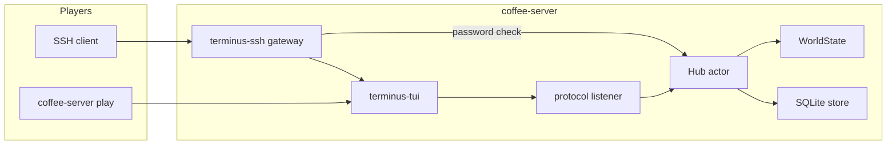

# Architecture

Coffee.shop is one process with a hard boundary between transport and rules.

`WorldState` implements `terminus_core::Game`. It accepts typed commands and returns a `GameView` plus the rows that must be saved. It does not read sockets or draw widgets.

`Hub` owns the world. Every login, command, and disconnect is a message to that task, so two players cannot interleave a mutation. After a successful transition the hub commits a `PersistOp` list inside one transaction. If the commit fails, the in-memory operator, message log, geography, social graph, settlements, waypoints, mailbox, and session overlays are restored.

The TUI renders `GameView` and sends command lines. It does not decide whether a move is legal. A `finding` stays beside the place description, and an `overlay` (journal, map, help) keeps that place on screen until `look`. SSH authentication calls the hub in-process and receives a session token. The terminal session then speaks the versioned protocol over a `0600` unix socket at `data/game.sock`. That socket is the same one `coffee-server play` uses. The gateway refuses `exec`, subsystems, environment changes, and forwarding.

`examples/minimal-game` implements `Game` and calls `terminus_tui::run_local`. It does not link `coffee-world`.

## Persistence boundary

Hand-authored locations and exits are defined in `coffee-world` and upserted on boot. That reseed updates location text and replaces the static exit graph. It does not touch procedural tables.

The database is the record of accounts, operators, positions, flags, items, the recent message log (capped at 200), personal waypoints, private mail, and persistent geography: materialized regions, structures, terrain modifications, discoveries, and explicit connections. Generated tiles are not stored. A command does not rewrite the whole world. Mail bodies live in `mail`, not in the capped message log.

Migrations live in `crates/coffee-world/migrations` and run when the store opens. `0001_init.sql` is the original schema. `0002_world.sql` adds the geography tables. A new `data/` directory is created on first start.

Region identity, generation versioning, and the Roof Array seam into the outskirts are described in [world architecture](world-architecture.md).

## Shutdown

Ctrl-C asks the SSH listener to stop, aborts protocol tasks, and lets the hub finish the message it is on. Each protocol connection drop detaches its operator and writes a leave line. The socket file is removed. The database is left in place.
